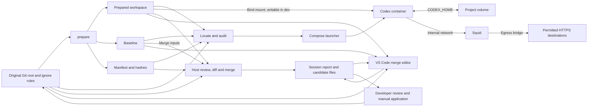

# dev-sandbox v1 architecture

The Bash launcher dispatches local workspace operations to Python and delegates container startup to Docker Compose. The original Git root identifies the workspace. Docker mounts the prepared copy, while the baseline and manifest remain on the host.

## Launcher and configuration

[`bin/dev-sandbox`](../bin/dev-sandbox) resolves its own path with `realpath` so installation through a symbolic link works. It executes the Python entry point directly for `prepare`, `review`, `diff`, `merge` and `resolve`. The Docker paths validate arguments and canonicalize the original path, reject broad paths, call the locator and auditor, and scan the resulting workspace again for selected sensitive filenames.

The launcher exports the mount path, runtime, mode and Compose project name. It loads `compose.yaml` and adds `compose.dev.yaml` for `dev`. All Docker paths run `docker compose config --quiet`. The `status` and `check` paths additionally pass rendered JSON to `inspect_config.py`, which checks the stack name, bind mount, image and build target, mount mode, selected privilege settings and network topology. Interactive mode and `check` require the selected image to exist locally. `check` runs `check_runtime.js` in a disposable container with `--no-deps`. Interactive mode invokes `docker compose run --rm` with the proxy dependency enabled.

## Preparation, identity and audit

- `prepare_workspace.py` requires the Git root, enumerates index paths with `git ls-files --cached -z --full-name`, deduplicates them, and reads the corresponding current working-tree files. It skips missing entries, symbolic links, non-regular files, oversized files and bytes that fail UTF-8 decoding or contain NUL.
- Mandatory basename globs run case-insensitively against every path component. They exclude `.dev-sandboxignore`, `.git`, environment files, SSH and AWS directories, package and network credential files, key and certificate containers, CSV and spreadsheet formats, database files, Terraform state, and names matching credential, secret, token, password or private-key filename patterns. `workspace_ignore.py` adds the project's current root-relative rules before any candidate content scan. The [preparation source](../bin/prepare_workspace.py) contains the exact globs and regular expressions.
- A recognized secret in an otherwise eligible file aborts preparation. The limits are 2 MiB per accepted file and 50 MiB total. The helper in `safe_files.py` uses descriptor-relative reads and bounds both the file metadata size and bytes read.
- Copies are staged as separate workspace and baseline trees, with prepared files set to `0600` and private directories set to `0700`. Preparation renames the staged trees into place and publishes a schema-v1 JSON manifest through an exclusive hard link to a temporary file. It checks both copies' hashes before publication and attempts cleanup on publication errors. The three artifacts are published in separate steps.
- The workspace ID uses the basename and the first 12 hexadecimal characters of the SHA-256 of the canonical original path. The Compose project uses `dev-sandbox-`, the lowercased basename with unsupported characters replaced by hyphens and truncated to 24 characters, and a 12-character path hash. Different modes and runtimes for the same original path share this Compose project.
- The manifest stores creation time in UTC, source, workspace and baseline paths, SHA-256 hashes keyed by copied relative path, and excluded paths. It records content identity for individual files. It is unsigned and the baseline remains writable by its host owner.
- `locate_workspace.py` validates the Git root, manifest association, expected baseline path, storage directories and manifest ownership and permissions. `audit_workspace.py` enumerates the current copy, checks current ignore rules, mandatory filters, regular-file reads, single-link status, content and size. The shared walk caps file and flagged entry enumeration at 10,000. Audit accepts eligible additions, modifications and deletions. It does not hash-check baseline contents or require the copy to match the preparation snapshot.

## Review, diff, merge and resolve

`review_workspace.py` compares the union of manifest paths and current workspace paths against the original working tree. It reports shape and hash changes, with a separate category for edits made only in the original. A conflict here means both sides diverged from the same baseline or a new workspace path is occupied in the original. It can still be mergeable at line level.

`diff_workspace.py` produces unified diffs for safe changes with an unchanged original, or for new paths absent from the original. It re-reads and checks hashes before printing and rejects selected terminal control characters in file contents. It can print eligible diffs even when other paths are blocked. It rejects more than 100 eligible changed files per invocation and truncates output at 300 diff lines per file.

`merge_workspace.py` validates the expected baseline and checks baseline content against manifest hashes as it reads applicable paths. It processes workspace changes by relative path. For two modified text versions it calls `git merge-file -p` with the current original as our version, the prepared baseline as the common ancestor, and the workspace as the other version. Inputs are temporary files and stdout becomes the candidate. This is a text merge without Git history or rename detection. The output of the three-way merge has a 4 MiB limit and is checked for NUL, escape characters and known secret patterns.

| Status | Meaning | Example |
| --- | --- | --- |
| `CREATE` | A workspace addition is absent from the original. | The agent adds `greeting_test.rb` and that path is absent from the original. |
| `READY` | The workspace changed a file and the original still matches the baseline. | The agent updates a greeting while the original file stays unchanged. |
| `DELETE` | The workspace removed a file and the original still matches the baseline. | The agent removes an unchanged obsolete example file. The report records the deletion without a candidate file. |
| `MERGED` | Both sides changed the text and Git returned a clean merge. | The developer edits the header and the agent edits a separate function. Git combines both edits. |
| `CONFLICT` | Git returned a merge with content conflict markers. | The developer and agent replace the same line with different greetings. |
| `MANUAL` | A new path already exists in the original, or one side deleted a file the other modified. | The agent removes a file that the developer edited. |

Original-only changes and files deleted by both sides need no output. Each successful invocation creates a fresh session with `merge-report.json` and output under `files/`. The report includes relative paths, statuses and output paths where present. A session containing `CONFLICT` or `MANUAL` exits with code 2.

`resolve_workspace.py` checks that the resolved session directory is directly under the project's merge directory and validates the report association. For each `CONFLICT` record, it invokes `code --wait --merge <original> <workspace> <baseline> <result>`. The inputs are the current files at those paths. Resolution targets the session output and leaves `MANUAL` cases to the developer. The tool does not refresh the report statuses or apply results to the original.

## Containers, network and state

The multi-stage [Dockerfile](../Dockerfile) starts from Node.js 24 on Debian Bookworm slim and installs Codex with a default build argument of `0.167.2`. Four targets add or check the tools listed in the [runtime table](../README.md#3-build-the-runtime-and-proxy-images). The [base Compose](../compose.yaml) runs Codex as `node`, with a read-only root filesystem, all capabilities dropped, no new privileges and a 128-process limit. A writable `/tmp` tmpfs and a writable named volume at `/home/node/.codex` are available in both modes. The [dev override](../compose.dev.yaml) changes only the workspace bind mount to writable. Neither Compose file mounts the host's Docker socket.

The Codex service joins only `codex_internal`, declared internal. Squid joins that network and `proxy_egress`, a separate bridge. The launcher supplies proxy settings through the Compose environment. [Squid's ACLs](../proxy/squid.conf) govern CONNECT requests, and the [security model](SECURITY.md#network-policy) describes their scope. Squid uses a read-only root filesystem, retains `SETUID` and `SETGID` after dropping all capabilities, and writes logs and working state to tmpfs. The configuration disables caching and publishes no host ports.

The project-scoped Docker volume `codex_home` persists authentication and other state that Codex writes to `CODEX_HOME` across one-off containers. The project delegates sign-in to Codex and does not mount the host's Codex directory. Switching modes, changing runtimes or replacing a copy at the same canonical path can reuse the volume. The launcher does not remove the volume or explicitly tear down the proxy when an interactive run ends.

## Architectural decisions and operational trade-offs

| Architectural decision | What it enables | Operational trade-off |
| --- | --- | --- |
| Copy filtered working-tree text | Gives the agent current tracked edits in a separate working copy. | Git history, executable permissions and excluded inputs are unavailable in the copy. |
| Keep an independent host baseline | Supplies the common ancestor for three-way merge. | The baseline uses extra disk space and falls under the same data retention and disposal policy as the copy. |
| Use canonical-path identity | Reuses the same workspace and Compose project for repeat runs at the same path. | Moving the original changes its identity and leaves the previous artifacts in storage. |
| Use Docker as the execution boundary | Runs the agent with the launcher’s `--sandbox danger-full-access --ask-for-approval on-request` settings. | Operators must validate the deployment against the [security model](SECURITY.md). |
| Save merge candidates for manual application | Gives developers a review point before changes reach the original. | Developers resolve collisions, check for stale inputs and apply accepted changes. |
| Route supported clients through Squid | Applies a common destination policy to proxied requests. | Dependency installation and sign-in can fail when they require destinations outside that policy. |
